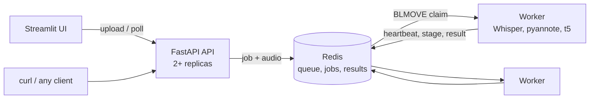

# Meeting Analyzer

Upload a meeting recording, get back a speaker-attributed transcript, a summary, action items and participation statistics. Every model runs on your own hardware (Whisper, pyannote, Sentence-BERT, t5); no external AI APIs.

It runs as a small set of services: a FastAPI API that accepts uploads, a Redis job queue, workers that run the models, and a Streamlit UI. It deploys with Docker Compose or Kubernetes, and CI tests the Kubernetes setup on a real cluster on every push.



## Why a queue

Analysing a meeting takes minutes. An HTTP request cannot wait that long (proxies time out, clients disconnect, a deploy kills it halfway), and running the models inside the web server would let one upload block every other user. So the API stores the audio, puts a job on a queue and answers `202 Accepted` with a job id immediately. Workers, which load the models once at startup, take jobs off the queue. Clients poll `GET /v1/meetings/{id}`.

This also splits scaling: the API needs little CPU and scales on requests; workers need several CPU cores and gigabytes of memory each and scale on load.

## API

```bash
curl -F file=@meeting.m4a -F abstractive=true http://localhost:8000/v1/meetings
# 202 {"id": "9f2c...", "status": "queued", "queue_position": 1, ...}

curl http://localhost:8000/v1/meetings/9f2c...
# {"status": "processing", "stage": "diarizing", "attempts": 1, ...}
# ... later
# {"status": "done", "processing_seconds": 212.4, "result": {...}}
```

| Endpoint | Purpose |
|---|---|
| `POST /v1/meetings` | Upload audio (wav, m4a, mp3, flac, ogg, webm, mp4). `202` with a job id, `413` over the size limit, `415` for other file types |
| `GET /v1/meetings/{id}` | Status (`queued`, `processing`, `done`, `failed`), current stage, queue position, and the result once done |
| `DELETE /v1/meetings/{id}` | Remove a job, its audio and its result |
| `GET /healthz` | Liveness: the process is up |
| `GET /readyz` | Readiness: Redis is reachable (`503` otherwise) |
| `GET /metrics` | Prometheus metrics |
| `GET /docs` | Interactive OpenAPI docs |

The result contains `summary`, `key_moments`, `action_items`, per-speaker stats in `speakers`, every `sentences` entry with speaker and timestamps, and per-stage `timings`.

## Reliability

**Crash-safe queue.** A worker claims a job with Redis `BLMOVE`, which moves the id from `queue` to `processing` in one atomic step, so a job is never in neither list. While working, the worker refreshes a heartbeat key with a TTL. If the worker dies (OOM kill, node failure, `kill -9`), the heartbeat expires and another worker's reaper puts the job back on the queue. The reaper requires a missing heartbeat on two passes in a row, so a job claimed a moment before its first heartbeat is never mistaken for an orphan, and it uses `LREM`'s return value so two reapers cannot requeue the same job twice.

**Retries with a limit.** Errors that might be temporary (out of memory, a model hiccup) are retried up to `MAX_ATTEMPTS` (3). Audio that ffmpeg cannot decode fails at once, since retrying cannot help.

**Graceful shutdown.** On `SIGTERM` (Kubernetes scale-down or rollout), a worker finishes its current job before exiting; the pod's `terminationGracePeriodSeconds` is 15 minutes to allow for it.

**Deduplication.** The API hashes each upload with SHA-256 while streaming it in. An identical file with the same options returns the existing job instead of running the models again. `SET NX` makes this atomic, so two simultaneous uploads of the same file still create one job.

**Bounded uploads.** Uploads are read in 1 MB chunks and rejected as soon as they pass `MAX_UPLOAD_MB`, without buffering the rest.

All of this is covered by tests (below), including killing a worker mid-job both as a local process and as a Kubernetes pod.

## Running it

### Docker Compose

```bash
echo "HF_TOKEN=hf_..." > .env          # pyannote's model is gated; see "Hugging Face access"
docker compose up --build
# UI: http://localhost:8501   API docs: http://localhost:8000/docs
docker compose up --scale worker=2      # more workers
```

To try the whole system without downloading models: `ANALYZER_BACKEND=fake docker compose up --build`. The fake backend returns a fixed result after a short delay; CI uses it.

### Kubernetes

```
k8s/
  base/               namespace, config, Redis (StatefulSet), API, worker, UI, HPA, PDB
  overlays/kind/      local cluster with the fake backend (used by CI)
  overlays/cloud/     real models + Ingress, for a cloud VM or cluster
  optional/           KEDA autoscaling on queue length
```

```bash
kubectl -n meeting-analyzer create secret generic hf-token --from-literal=token=hf_...
kubectl apply -k k8s/overlays/cloud
```

What the manifests do:

- **API:** 2 replicas behind a Service, a readiness probe on `/readyz` (no traffic until Redis is reachable), a liveness probe on `/healthz`, and a PodDisruptionBudget so node maintenance never takes both down.
- **Worker:** requests 2 CPUs and 4 GiB, caches downloaded models in a volume, and scales 1 to 4 replicas on CPU through a HorizontalPodAutoscaler with a 10-minute scale-down window so idle workers are not killed between jobs. `k8s/optional/keda-scaledobject.yaml` scales on queue length instead, down to zero.
- **Redis:** a StatefulSet with a persistent volume and append-only persistence, so queued jobs survive a restart; `noeviction` so Redis never silently drops jobs when memory is full.
- **Ingress:** `/v1` and `/docs` go to the API, everything else to the UI.
- **Secrets:** the Hugging Face token comes from a Kubernetes Secret, never from the image or the repo.

### Google Cloud

[`deploy/gcp.md`](deploy/gcp.md) walks through running the stack on k3s on one Compute Engine VM: create the VM, install k3s, build and import the images, add the token, and open it on a public IP.

### Without Docker

```bash
pip install -r requirements-api.txt -r requirements-ml.txt -r requirements-ui.txt
redis-server &
uvicorn service.api:app_factory --factory --port 8000 &
python -m service.worker &
API_URL=http://localhost:8000 streamlit run app.py
```

Requires Python 3.10+ and ffmpeg.

## Configuration

| Variable | Default | |
|---|---|---|
| `REDIS_URL` | `redis://localhost:6379/0` | |
| `ANALYZER_BACKEND` | `real` | `fake` for tests and demos without models |
| `STORAGE_BACKEND` | `redis` | `s3` to keep audio in S3, Google Cloud Storage (S3 API) or MinIO; set `S3_BUCKET`, `S3_ENDPOINT_URL` |
| `MAX_UPLOAD_MB` | `50` | |
| `MAX_ATTEMPTS` | `3` | retries for transient failures |
| `HEARTBEAT_TTL_SECONDS` | `30` | how long a dead worker holds a job before it is requeued |
| `WHISPER_MODEL` | `small` | `base` is faster, `medium` more accurate |
| `HF_TOKEN` | | Hugging Face token for pyannote |

## How the analysis works

1. **Convert** the upload to 16 kHz mono WAV with ffmpeg.
2. **Transcribe** with Whisper using word-level timestamps.
3. **Diarize** with pyannote into `(start, end, speaker)` turns.
4. **Align** each word to the turn it overlaps most. Turns are sorted and searched with binary search, so each word only checks nearby turns instead of every turn. A word with no overlap takes its neighbours' speaker when they agree.
5. **Sentences:** consecutive words from one speaker are merged and split on `.`, `!`, `?`. Sentence times are estimated by sharing the block's time by character count.
6. **Summary:** sentences are embedded with `all-MiniLM-L6-v2`; the five closest to the meeting's average embedding become key moments, which t5-base turns into a short summary.
7. **Action items:** a sentence counts if it has a modal (`will`, `need to`, `should`...) and an action verb (`send`, `review`, `schedule`...) and no hedge (`maybe`, `might`, `consider`...).
8. **Participation:** talk time, turns, and share of the meeting per speaker.

## Testing

```bash
pip install -r requirements-dev.txt
pytest -q          # starts a local redis-server, or uses REDIS_URL
```

- **Pipeline stages:** speaker alignment checked against a brute-force version on random data, edge cases in unknown-speaker filling, sentence splitting, action items, dominance.
- **Pipeline wiring:** the real `analyze()` with stand-in models shaped like Whisper, pyannote, Sentence-BERT and t5, on audio generated with ffmpeg.
- **Service, against real Redis:** upload and completion, deduplication, size and type limits, queue positions, retries then failure, immediate failure on bad audio, a crashed worker's job being requeued and finished by another, a live long job *not* being requeued, and 4 workers draining 40 jobs with each job processed exactly once.
- **Kubernetes (CI):** builds the images, deploys the kind overlay to a kind cluster, runs a job end to end, then force-deletes the worker pods mid-job and checks the job still completes.

CI also validates every overlay against the Kubernetes API schemas and builds the full worker image to check the ML libraries install and import.

## Hugging Face access

pyannote's diarization model is gated:

1. Accept the terms at [pyannote/speaker-diarization-3.1](https://huggingface.co/pyannote/speaker-diarization-3.1) and [pyannote/segmentation-3.0](https://huggingface.co/pyannote/segmentation-3.0).
2. Create a read token at [huggingface.co/settings/tokens](https://huggingface.co/settings/tokens) and pass it as `HF_TOKEN`.

## Limitations

- Speakers are labelled `SPEAKER_00`, `SPEAKER_01`; there is no name resolution.
- Sentence timestamps are estimated from character counts, so they drift within long speaker blocks.
- Action items are keyword-based and miss indirect phrasing.
- Overlapping speech is a weak point for word-to-speaker alignment.
- Results are polled. Server-sent events or a webhook would avoid polling.

## Layout

```
analyzer/      ML pipeline (text.py has no ML imports and is fully unit-tested)
service/       API, job queue, worker, audio storage
app.py         Streamlit UI (a client of the API)
docker/        Dockerfiles for api, worker, ui
k8s/           Kubernetes manifests (kustomize)
deploy/        Google Cloud guide
scripts/       Kubernetes end-to-end test
tests/
notebooks/     original prototype
```
